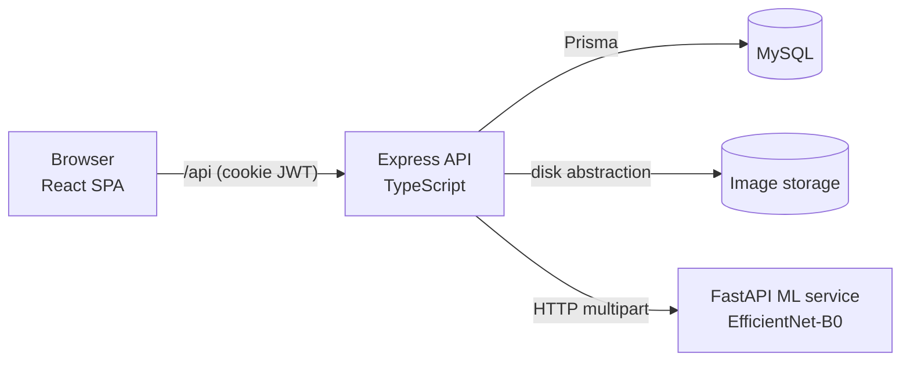
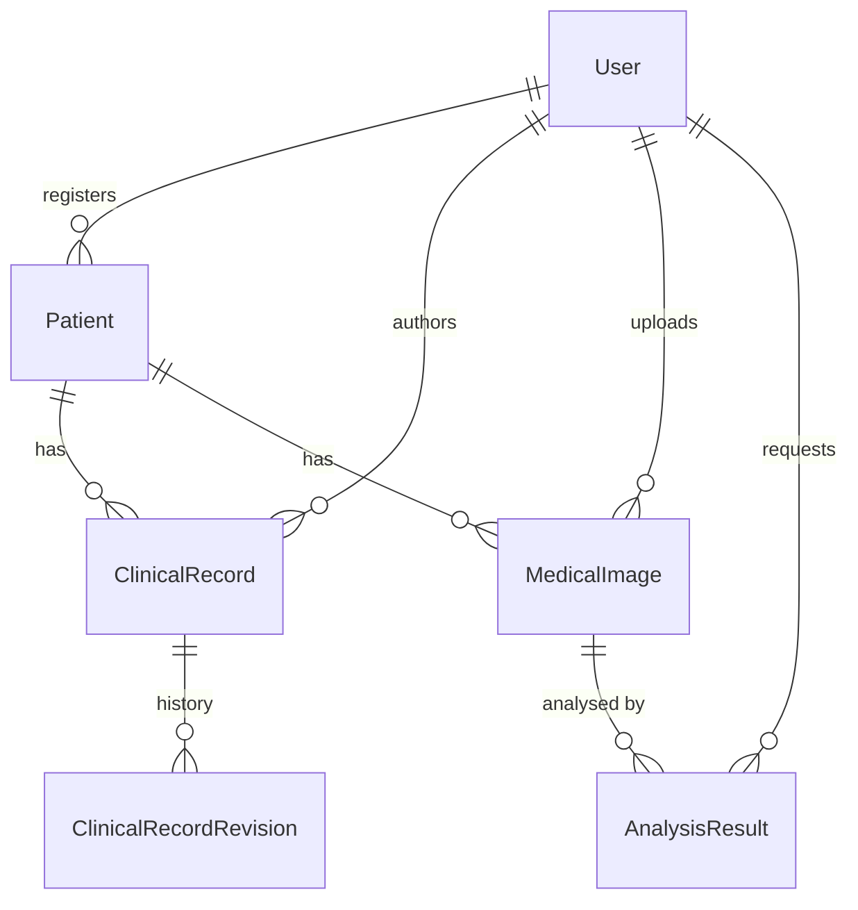

# CEVI — Clinical Decision-Support Research Prototype

A full-stack, interview-ready research workspace that links **structured clinical records** and **medical
imaging** to an **EfficientNet-B0 inference service**, behind role-based access control.

> **Research prototype · synthetic data only.** CEVI is not a medical device, is not clinically validated, makes no
> HIPAA/regulatory claims, and its model output must never be used for diagnosis or treatment decisions.

| | |
|---|---|
| Frontend | React 18 · TypeScript · Vite · Tailwind · shadcn-style components (Radix) · TanStack Query · React Router · Recharts |
| Backend | Node.js · Express · TypeScript · Prisma · MySQL · Zod · JWT (httpOnly cookie) · RBAC |
| ML service | Python · FastAPI · PyTorch · torchvision EfficientNet-B0 · Pillow · NumPy |
| Quality | Vitest · React Testing Library · Supertest · Pytest · ESLint · Prettier |
| Infra | Docker / Compose (optional) · local no-Docker scripts for 8 GB machines |

## Problem statement

Imaging research teams juggle patient context, clinical notes, image files and model experiments in disconnected
tools, with weak access control and no audit trail. CEVI demonstrates a coherent workflow — register a (fictional)
patient → record observations → upload an image → run a transparent, clearly-labelled model experiment → review
history and operational analytics — while keeping service boundaries explicit and the model's limits honest.

## Quick start (no Docker)

Prerequisites: Node 20+, Python 3.11–3.13, a MySQL 8 binary (`brew install mysql`; no running server required).

```bash
# one-time setup
cd backend  && npm install && cp .env.example .env     # then set JWT_SECRET (>= 32 chars)
cd ../frontend && npm install
cd ../ml-service && python3.13 -m venv .venv && .venv/bin/pip install -r requirements.txt
cd .. && ./scripts/db-start.sh                          # project-local MySQL on :3307 (own datadir)
cd backend && npx prisma migrate deploy && npm run db:seed

# every time
./scripts/start.sh      # MySQL → ML → API → Web, waits for health checks
./scripts/stop.sh
```

Open **http://localhost:5173**. Demo accounts (password `CeviDemo2026!`, local seeded DB only):

| Role | Email |
|---|---|
| Clinician | `clinician@cevi.demo` |
| Researcher | `researcher@cevi.demo` |
| Administrator | `admin@cevi.demo` |

URLs: web `:5173` · API `:4000/api` (health: `/api/health`) · ML `:8001` (`/health`, `/model`) · MySQL `:3307`.

The first ML start downloads the 21 MB torchvision EfficientNet-B0 ImageNet weights into `.local/torch/`
(project-local). Set `CEVI_WEIGHTS=none` to run architecture-only (inference then reports *unavailable*).

### Docker (optional)

```bash
echo "JWT_SECRET=$(openssl rand -hex 32)" > .env
docker compose up --build        # mysql (512 MB cap) + ml-service (1 GB cap) + backend
```
The Compose files were written for this repo but **not executed** during development (the target 8 GB machine
was kept free of containers), so treat them as unverified.

## Portfolio demo (browser-only)

`cd frontend && npm run build:demo` produces a static, backend-free build (`dist-demo/`) that replays a snapshot of
this application's synthetic data and **recorded** model results entirely in the browser, suitable for Cloudflare
Pages Free. The normal full-stack build is unaffected. See [`docs/PORTFOLIO_DEMO.md`](docs/PORTFOLIO_DEMO.md).

## Architecture



* **API is the only coordinator.** The browser never talks to the ML service. The API validates the upload,
  stores bytes through a `StorageProvider`, persists metadata in MySQL, calls the ML service with a timeout, and
  records every outcome (including failures) as an `AnalysisResult`.
* **Clinical text never reaches the image model.** Selected records are snapshotted into
  `AnalysisResult.contextSnapshot` for reviewers; the contract to the model is image-bytes-in, predictions-out.
* **Authorization lives in the API** (`lib/permissions.ts` → `requirePermission`); the UI only mirrors it.

```
backend/src
  config/env.ts           zod-validated environment
  lib/                    prisma, storage, mlClient, imageValidation, permissions, serializers, stats
  middleware/             auth, validate, errorHandler, rateLimit
  modules/                auth · users · patients · records · images · analyses · analytics · dashboard · search
frontend/src
  api/hooks.ts            typed TanStack Query hooks + mutation invalidation
  components/ui           design-system primitives     components/forms   dialogs with validation
  pages/                  Overview · Patients · PatientDetail · Records · Imaging · Analysis · History · Analytics · Users · Settings
ml-service/app            config · validation · preprocessing · model · main (FastAPI)
```

## Database schema

Five core entities (plus two supporting tables) in MySQL via Prisma; migrations in `backend/prisma/migrations`.



| Table | Purpose / notable constraints |
|---|---|
| `User` | unique email, bcrypt hash, `role` enum, `isActive`, `lastLoginAt` |
| `Patient` | unique `syntheticId` (SYN-000123), cohort, `caseStatus`, `isSynthetic`; indexes on name, status, cohort |
| `ClinicalRecord` | FK patient + author (`Restrict`), type/severity enums, `version`; index (patientId, recordedAt) |
| `MedicalImage` | **metadata only** — unique `storageKey`, mime, size, dimensions, sha256, `processingStatus`; bytes live outside the DB |
| `AnalysisResult` | FK image + requester; status/mode enums, model name/version/weights source, `predictions` JSON, `preprocessing` JSON, `contextSnapshot` JSON, timings, error |
| `ClinicalRecordRevision` | immutable prior versions, unique (recordId, version) |
| `ActivityLog` | audit feed powering notifications and dashboards |

All foreign keys are `Restrict` (no silent cascades of clinical data); patients are closed, not deleted.

## Machine-learning pipeline

1. **Validate** — signature (PNG/JPEG magic bytes), size ≤ 8 MB, header dimensions (32 – 8192 px, ≤ 40 MP) *before*
   decoding pixels, then a full decode so truncated files fail early.
2. **Preprocess** — RGB conversion (alpha composited on white, 16-bit scaled) → bicubic resize of shorter side to
   256 → centre-crop 224×224 → ÷255 → ImageNet mean/std normalisation → `float32` tensor `(1,3,224,224)`.
3. **Infer** — `torchvision.models.efficientnet_b0` with `IMAGENET1K_V1` weights, `torch.inference_mode`, softmax,
   top-5. Metadata and a disclaimer ride along with every response.

**What the output means:** the available weights were trained on ImageNet-1k *everyday objects*. A synthetic
phantom might be labelled "ping-pong ball" — that is a demonstration of the plumbing, **not** a medical finding.
No accuracy, sensitivity or other clinical metric is claimed because none has been measured. If weights are
unavailable the service returns `503 MODEL_WEIGHTS_UNAVAILABLE` and CEVI records an `UNAVAILABLE` analysis with
no predictions.

## Authentication & authorization

* bcrypt (cost 12) password hashing; constant-time-ish login path with a dummy hash for unknown emails and one
  generic error message.
* JWT (8 h) in an **httpOnly, SameSite=Lax** cookie (`Secure` in production). Every request re-loads the user, so
  deactivation and role changes apply immediately — the token's role claim is never trusted.
* Roles → permissions matrix in [`docs/API.md`](docs/API.md). Researchers receive anonymized patients (no names or
  DOB), and name-based search is disabled for them so identities cannot be inferred.
* Helmet headers, CORS allow-list, request body limit, per-route rate limits (login, analysis), request timeouts,
  metadata-only logging, structured error responses without stack traces.

## Testing

```bash
cd backend    && npm test         # Vitest + Supertest against isolated `cevi_test` DB (45 tests)
cd frontend   && npm test         # Vitest + React Testing Library (24 tests)
cd ml-service && .venv/bin/python -m pytest -q   # 23 tests, includes real inference
```
Backend tests mock only the ML HTTP boundary; everything else uses the real MySQL test database.
Lint/type-check: `npm run lint && npm run typecheck` in `backend` and `frontend`.

## Environment configuration

See `backend/.env.example`. Key variables: `DATABASE_URL`, `JWT_SECRET` (≥ 32 chars, required), `CORS_ORIGIN`,
`ML_SERVICE_URL`, `ML_TIMEOUT_MS`, `STORAGE_DIR`, `MAX_UPLOAD_MB`. ML service: `CEVI_WEIGHTS` (`imagenet` |
`none` | path to a `state_dict`), `CEVI_TORCH_THREADS`, `CEVI_TOP_K`.

## Known limitations

* Research prototype — **not** clinically validated; no regulatory or HIPAA assessment.
* Pretrained weights are general-purpose ImageNet, so predictions are not medically meaningful.
* Single-node: analyses run synchronously inside the request (bounded by `ML_TIMEOUT_MS`); no job queue.
* Local-disk image storage; no virus scanning, DICOM support or de-identification pipeline.
* JWT cookie sessions have no refresh/revocation list beyond per-request user checks; CSRF relies on SameSite + JSON.
* Docker Compose is provided but was not executed in this environment.
* Charts/UI are tested for rendering and behaviour, not pixel-level visual regression.

## Future improvements

Background job queue (BullMQ/Redis) and websocket status; object storage (S3) behind the existing
`StorageProvider`; DICOM ingest with de-identification; fine-tuning and validation of a domain model on a licensed
dataset with proper calibration and evaluation; Grad-CAM explanations; audit-log export; OpenAPI generation from the
Zod schemas; Playwright E2E in CI.
